## What Is Statistical Learning?

we observe a quantitative response Y and p different predictors, X1, X2, . . . , Xp. We assume that there is some relationship between Y and X = (X1, X2, . . . , Xp), which can be written in the very general form

```
Y= f (X) + ϵ.
```

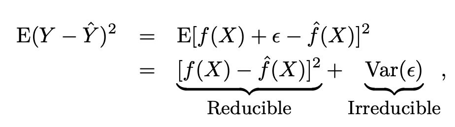

- modeling for inference:
    - to what extent is the product’s price associated with sales?
    - how much extra will a house be worth if it has a view of the river?
- prediction problem:
    - is this house under- or over-valued?

### Parametric Methods

Parametric methods involve a two-step model-based approach.

1. First, we make an assumption about the functional form, or shape, of f .
   For example, one very simple assumption is that f is linear in X:

```
f (X) = β_0 + β_1X_1 + β_2X_2 +· · · + β_pX_p
```

2. After a model has been selected, we need a procedure that uses the
   training data to fit or train the model. In the case of the linear model (2.4), we need to estimate the parameters β0, β1, . . . , βp. (example: least squares)

### Non-parametric Methods

Non-parametric methods do not make explicit assumptions about the functional form of f. Instead they seek an estimate of f that gets as close to the data points as possible without being too rough or wiggly.

1. No assumption about the form of f is made, far more observations needed.
2. We use splines
   But non-parametric approaches do suffer from a major disadvantage: since they do not reduce the problem of estimating f to a small number of parameters, a very large number of observations (far more
   than is typically needed for a parametric approach) is required in order to
   obtain an accurate estimate for f.

If we don't have enough observation, we could over-fit and our function will start to trace errors closely.

increase smoothnes -> increace C class.
C0 - ciągła
C1 - 1 różniczkowalna itd

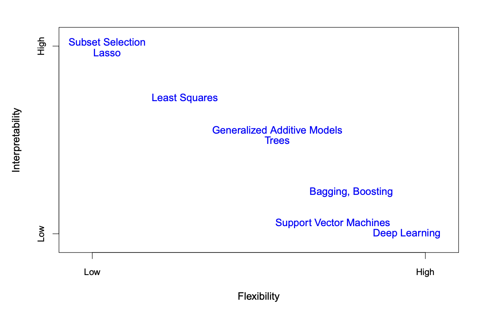

### Regression Versus Classification Problems

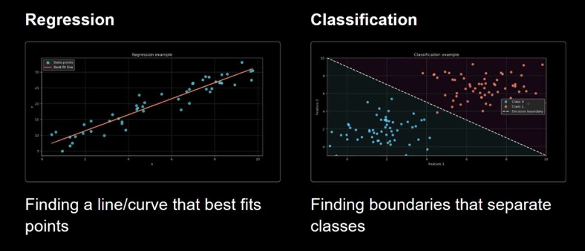

Variables can be characterized as either quantitative or qualitative (also quantitative
known as categorical).

- Quantitative variables take on numerical values.
    - person’s age, height, or income, the value of a house, the price of a stock.
    - Least squares linear regression
- Qualitative variables take on values in one of K different classes, or categories
    - person’s marital status (married or not), the brand of product purchased (brand A, B, or C), whether a person defaults on a debt (yes or no), or a cancer diagnosis (Acute Myelogenous Leukemia, Acute Lymphoblastic Leukemia, or No Leukemia).
    - logistic regression (two-class, or binary response)

We tend to refer to problems with a quantitative response as regression problems, while those involving a regression qualitative response are often referred to as classification problems.

Thus, despite its name, logistic regression is a classification method.
But since it estimates class probabilities, it can be thought of as a regression method as well. Some statistical methods, such as K-nearest neighbors and boosting, can be used in the case of either quantitative or qualitative responses.

### Regression

Predicts continuous, numerical values (house prices, temperature forecast, exam scores, income predictions, stock prices)

- evaluations:
    - MSE (Mean square error) - average of squared differences between predictions and actual value.
      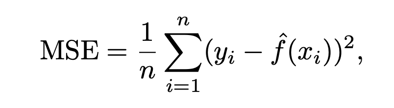
    - MAE (Mean absolute error) - average of absolute differences between predictions and actual values.
    - RMSE (Root mean squared error) - square root of MSE

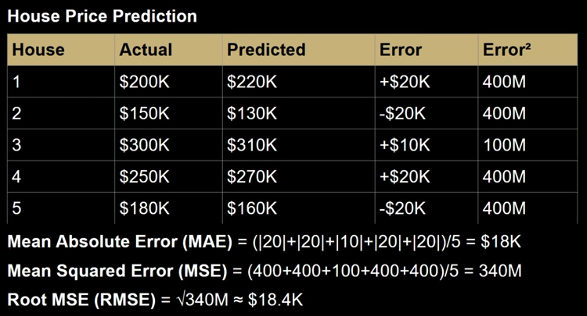

### Classification

Predicts discrete categories/classes. (email spam/ not spam; healthy/unhealthy; cat/dog/bird)
Can be Binary or Multi-class

- evaluations:
    - Accuracy - % correctly classified instances. (TP + TN)/(TP+FP+TN+FN)
    - Precision - TP / (TP + FP) - correct positives / all marked as positives. Are we correct in our positive predictions?
    - Recall - TP / (TP + FN) - correct positives / all that should have been marked as positives. How good are we in identifying positives?
    - F1 - 2\*(Precision \* Recall) / (Precision + Recall)

    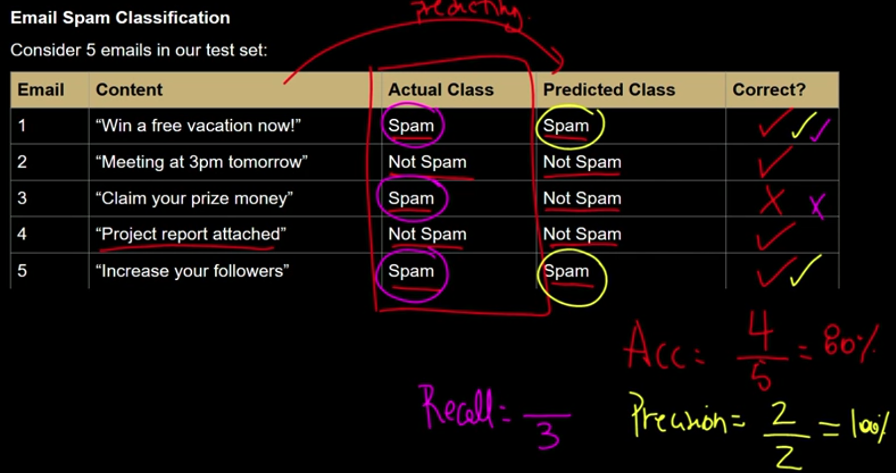

### Supervised Learning

We feed a learning algorithm a data set of inputs (features/predictors) and their correct outputs (responses/labels). Algorithm learns to map inputs -> outputs.
Training data includes known correct answers.

For each example around training data the model can compare its prediction to the actual answer and improve itself.

- clear goal, success measured by prediction error, labeled data
- regression, classification

### Unsupervised Learning

- exploratory goal, discover structure. Success more subjective, no labeled data needed
- clustering - customer types based on spending habits
- hierarchical clustering of species based on dna (dendrogram) - groupings on multiple levels

## Complexity and Interpretability

Interpretability - The ability to understand and explain how a model makes decisions.
Being able to trace reasoning from input to output. Understanding feature importance and relationships

Complexity - Number of parameters, non-linear relationships, etc
Ability to fit intricate patterns into the data. More complex models can capture nuanced relationships but become harder to interpret

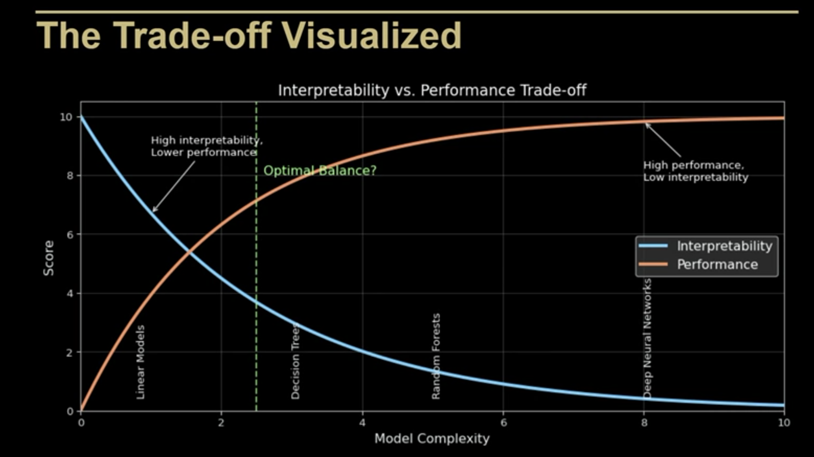

## Assessing Model Accuracy (28)

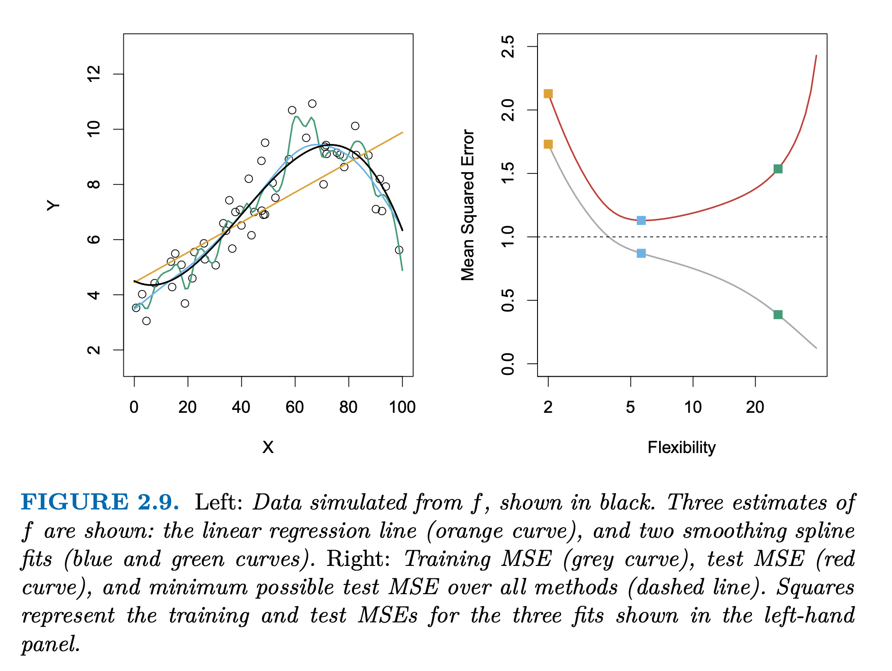

In the right-hand panel of Figure 2.9, as the flexibility of the statistical learning method increases, we observe a monotone decrease in the training MSE and a U-shape in the test MSE. This is a fundamental property of statistical learning that holds regardless of the particular data set at hand and regardless of the statistical method being used. As model flexibility increases, the training MSE will decrease, but the test MSE may not

## The Bias-Variance Trade-Off

Bias - how far predictions are from true values
Variance - how much predictions vary

The expected test MSE, for a given value x0, can always be decomposed into the sum of three fundamental quantities:

- the variance of f'(x0),
- the squared bias of f'(x0)
- the variance of the error terms ϵ

expected test MSE at x0:
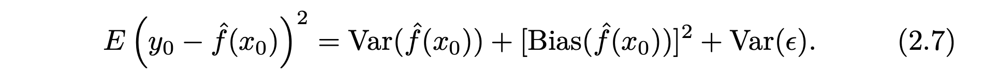

expected test MSE can never lie below Var(ϵ), squared bias and variance are nonnegative values

1. Variance refers to the amount by which f' would change if we estimated it using a different training data set.
    1. If a method has high variance, then small changes in the training data can result in large changes in f'
    2. More flexible statistical methods have higher variance
    3. Leads to over-fitting. Complex polynomial will fit random noise. Excellent performance on training data but poor on test data
2. Bias refers to the error that is introduced by approximating a real-life problem, which may be extremely complicated, by a much simpler model.
    1. Example: linear regression assumes that there is a linear relationship between Y and X1, X2, . . . , Xp, which is unlikely in any real-life scenario. Poor performance on both training and test data
    2. More flexible methods result in less bias
    3. High bias -> model makes strong assumptions about the data (under-fitting - we don't capture all the real patterns of real data).

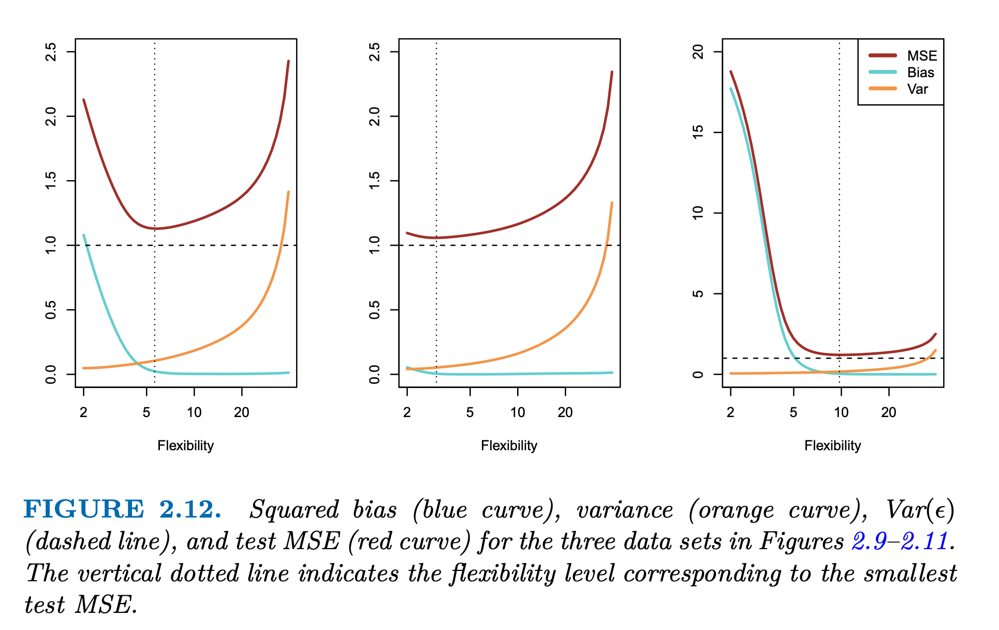

As a general rule, as we use more flexible methods, the variance will increase and the bias will decrease. The relative rate of change of these two quantities determines whether the test MSE increases or decreases. As we increase the flexibility of a class of methods, the bias tends to initially decrease faster than the variance increases. Consequently, the expected test MSE declines. However, at some point increasing flexibility has little impact on the bias but starts to significantly increase the variance. When this happens the test MSE increases.

In a real-life situation in which f is unobserved, it is generally not possible to explicitly compute the test MSE, bias, or variance for a statistical
learning method.

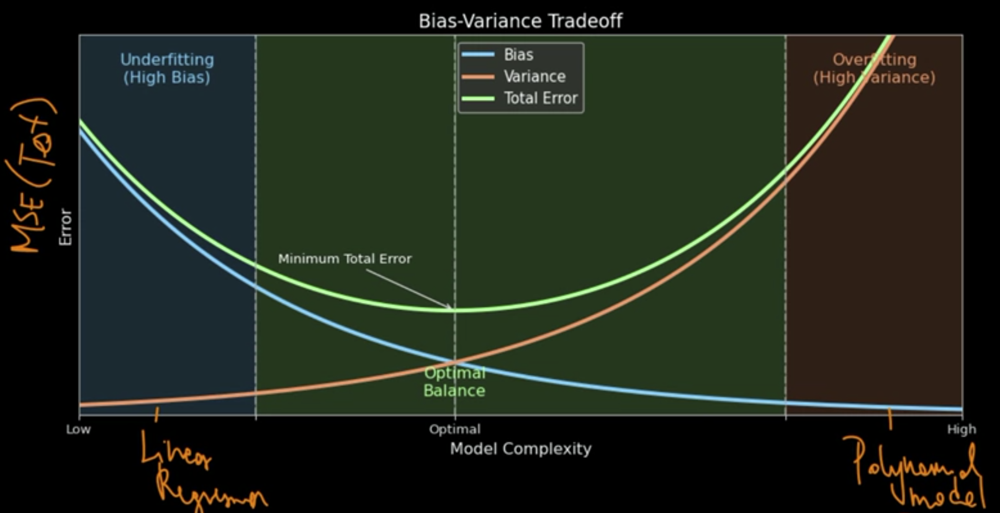

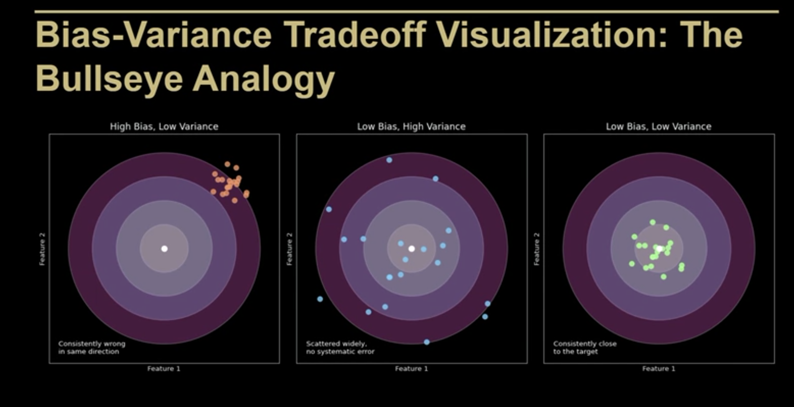

## The Classification Setting

Suppose that we seek to estimate f on the basis of training observations {(x1, y1), . . . , (xn, yn)}, where now y1, . . . , yn are qualitative. The most common approach for quantifying the accuracy of our estimate
f' is the training error rate, the proportion of mistakes that are made if we apply our estimate f' to the training observations:
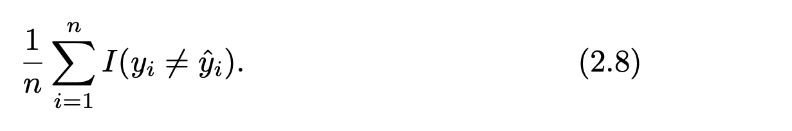

yi' is the predicted class label for the ith observation using f'. I() is = 1 when the prediction was incorrect.

### The Bayes Classifier
